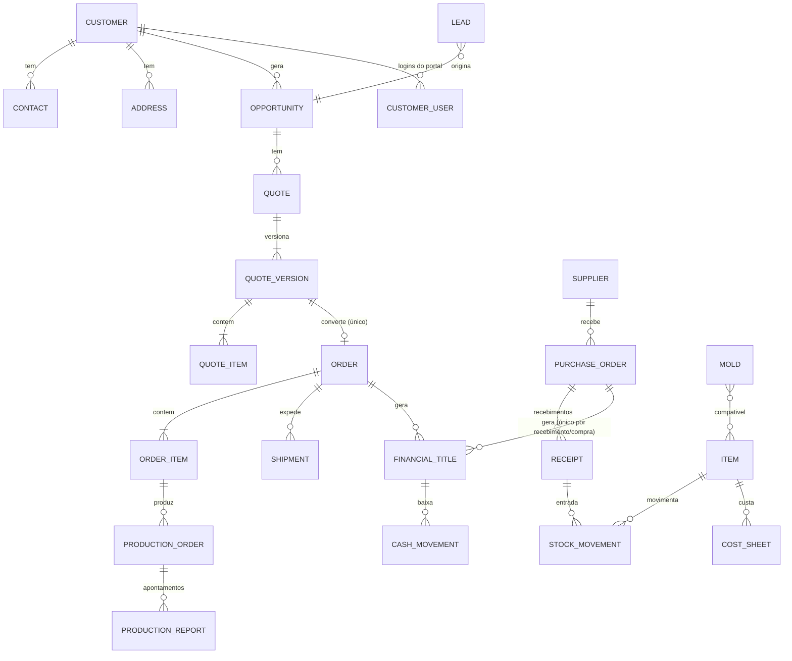

# 03 — Modelo de dados (PostgreSQL)

Convenções: `id uuid` (PK), `created_at`, `updated_at`, `created_by`, `updated_by` em todas as tabelas; nomes em inglês no banco, rótulos em português na interface; valores monetários em `numeric(14,2)` (custos unitários em `numeric(14,6)`); quantidades em `numeric(14,3)`; **exclusão lógica** (`active`/`archived_at`) em cadastros.

## Visão geral dos relacionamentos

## Domínios e tabelas

### Identidade e acesso
| Tabela | Campos principais |
|---|---|
| `profiles` | `id` (= `auth.users.id`), nome, telefone, ativo |
| `user_roles` | `user_id`, `role` (admin, gestor, comercial, producao, estoque, compras, financeiro) — um usuário pode ter mais de um |
| `customer_users` | `user_id`, `customer_id`, `contact_id`, `access_level` (leitura, aprovador, financeiro) — **vincula login do portal a uma empresa** |
| `settings` | regras e limites configuráveis (chave/valor versionado) |

### CRM
| Tabela | Campos principais |
|---|---|
| `customers` | razão social, nome fantasia, `cpf_cnpj` **único**, segmento, origem, `owner_id`, condições comerciais (jsonb), observações internas, ativo |
| `contacts` | `customer_id`, nome, cargo, telefone, WhatsApp, e-mail |
| `addresses` | `customer_id`, tipo (faturamento/entrega), endereço completo, CEP |
| `leads` | origem (landing/loja/WhatsApp/manual), `interest_type` (produto_existente \| projeto_exclusivo), payload, status, `dedupe_key`, `opportunity_id` |
| `pipeline_stages` | nome, ordem, tipo (aberta/ganha/perdida) — **funil configurável** |
| `loss_reasons` | motivos de perda configuráveis |
| `opportunities` | `customer_id`, `stage_id`, `owner_id`, valor estimado, tipo, motivo de perda |
| `activities` | `opportunity_id`/`customer_id`, tipo, descrição, `due_at`, `done_at`, responsável |
| `attachments` | `entity_type`, `entity_id`, `storage_path`, `visibility` (interno \| cliente), tipo, tamanho, hash — **bucket privado** |
| `messages` | thread por entidade, autor, corpo, `visibility` |

### Produtos e processo
| Tabela | Campos principais |
|---|---|
| `items` | `type` (produto_acabado, materia_prima, componente, embalagem_auxiliar, servico), `sku` **único**, categoria, descrição, unidade, dimensões, peso, capacidade, material, cor/acabamento, mín./múltiplo de venda, prazo estimado, ativo |
| `item_variants` | `item_id`, cor, acabamento, SKU da variante |
| `uom_conversions` | `item_id`, de, para, fator |
| `price_tiers` | `item_id`, `qty_min`, preço, vigência |
| `bom_lines` | `item_id` (acabado), `component_id`, quantidade, perda % |
| `routings` / `routing_steps` | roteiro por item: etapas ordenadas (injeção/sopro, rebarbação, montagem…) |
| `machines` | código, tipo (injeção/sopro), capacidade, status |
| `molds` | código, `ownership` (empresa \| cliente), `customer_id`, local, cavidades, status, manutenção |
| `mold_items`, `machine_molds` | compatibilidade molde↔item e molde↔máquina |

### Custos (somente interno)
| Tabela | Campos principais |
|---|---|
| `cost_parameter_sets` | vigência, `status` (rascunho \| validado), validado por/em |
| `cost_parameters` | `set_id`, chave (ex.: `custo_hora_maquina:INJ-01`), valor, unidade |
| `cost_sheets` | `item_id` ou `quote_item_id`, versão, snapshot dos parâmetros (jsonb), custo e preço sugerido |
| `cost_sheet_lines` | `sheet_id`, bloco (materia_prima, processo, mao_de_obra, preparacao, embalagem, terceirizado, despesa_fixa, imposto, margem), descrição, quantidade, valor, origem |

### Orçamentos
| Tabela | Campos principais |
|---|---|
| `quotes` | número **único**, `customer_id`, `contact_id`, `owner_id`, `opportunity_id`, status |
| `quote_versions` | `quote_id`, `version` (**único com quote_id**), status, validade, condições de pagamento, frete, prazo, totais, **snapshot (jsonb)**, `pdf_path`, `approved_by_user`, `approved_at`, `approved_ip` |
| `quote_items` | `version_id`, `item_id`, especificação, quantidade, preço unit., desconto, **custo (interno)** |
| `quote_approvals` | aprovações **internas** (quem, limite excedido, justificativa) |
| `quote_change_requests` | pedidos de alteração do cliente |

### Projetos exclusivos
`projects` (cliente, oportunidade/orçamento, etapa, responsável, prazo) · `project_files` (versionados) · `project_approvals` (técnica e de amostra) · `samples` (lote de amostra, resultado).

### Pedidos e produção
| Tabela | Campos principais |
|---|---|
| `orders` | número, `customer_id`, `quote_version_id` **ÚNICO**, `channel` (orçamento \| loja), `status_commercial`, `status_financial`, `status_production`, `status_logistics`, condições |
| `order_items` | `order_id`, `item_id`, quantidade, preço, `qty_produced`, `qty_shipped` |
| `order_release_rules` | condições exigidas por pedido e se estão atendidas (quem liberou exceção) |
| `production_orders` | `order_item_id`, máquina, molde, roteiro, status, quantidade planejada |
| `production_steps` | etapa da OP, status, responsável |
| `production_reports` | apontamento: produzida, aprovada, rejeitada, perda, retrabalho, parada, ocorrência, lote, consumo real |
| `quality_inspections` | `production_order_id`/`lot_id`, resultado, liberado por |
| `lots` | código de lote, item, origem (OP ou recebimento) |

### Estoque
| Tabela | Campos principais |
|---|---|
| `stock_locations` | código, descrição |
| `stock_movements` | **livro-razão imutável**: `item_id`, `location_id`, `lot_id`, `qty` (±), tipo (entrada, saída, transferência, ajuste, consumo, producao), `ref_type`/`ref_id`, `reversal_of` |
| `stock_reservations` | `order_item_id`, `item_id`, quantidade, status |
| `stock_balances` | **visão** calculada (físico, reservado, disponível) |

### Compras
`suppliers` · `purchase_requests` · `rfqs` + `rfq_quotes` (fornecedor, preço, prazo, condição) · `purchase_orders` + `purchase_lines` · `receipts` + `receipt_lines` (parciais) · `receipt_discrepancies`. **Restrição**: `financial_titles(origin_type, origin_id)` único para impedir duplicidade de título por compra/recebimento.

### Financeiro
| Tabela | Campos principais |
|---|---|
| `bank_accounts`, `cost_centers`, `finance_categories` | cadastros |
| `financial_titles` | tipo (receber \| pagar), origem (`order`, `purchase_order`, `manual`), valor, vencimento, **competência**, status, saldo |
| `title_installments` | parcelas |
| `cash_movements` | conta, valor, data, tipo (entrada, saída, **transferência**), `transfer_group_id`, `title_id` (opcional), `reversal_of` |
| `payment_proofs` | comprovante enviado pelo cliente, status (**pendente** \| validado \| recusado), validado por |
| `bank_statement_lines` | linhas importadas/lançadas p/ **conciliação manual** |

### Expedição
`shipments` (pedido, status, transportadora/responsável, previsão, data efetiva, rastreio) · `shipment_items` (item do pedido, quantidade, volumes, peso) · documentos via `attachments`.

### Loja
`store_products` (item, publicado, preço de loja, mínimo/múltiplo, disponibilidade) · `carts`, `cart_items` · `store_payments` (provedor, `external_id`, status, bruto, taxa) — **só preenchida quando houver provedor real**.

### Transversais
`audit_log` (ator, ação, entidade, antes/depois, data, IP) · `notifications` (destinatário, evento, lida) · `integration_logs` (integração, direção, status, payload resumido) · `idempotency_keys` (chave, escopo, resultado).

## Restrições que garantem as regras

| Regra | Como o banco garante |
|---|---|
| Um orçamento aprovado gera **um** pedido | `UNIQUE (orders.quote_version_id)` + função transacional com chave de idempotência |
| Versão enviada não muda | gatilho bloqueia `UPDATE` em `quote_versions` com status ≥ enviado; alterações criam nova versão |
| Saldo não é editado | `stock_movements` sem `UPDATE/DELETE`; correção via linha com `reversal_of` |
| Sem lançamento financeiro duplicado | `UNIQUE (financial_titles.origin_type, origin_id)` |
| Transferência não é receita/despesa | tipo `transferencia` com `transfer_group_id`; relatórios de resultado ignoram esse tipo |
| Cliente só vê a própria empresa | políticas RLS por `customer_users` (ver `04`) |
| Custos nunca vão ao portal | custos ficam em tabelas/visões sem política para o papel `cliente`; portal lê **visões** próprias |
| Cadastro usado não é apagado | `ON DELETE RESTRICT` + inativação |
